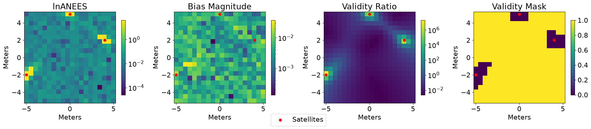

# The Consistency of Covariance Estimates in Symmetric Maximum Likelihood Estimation



This repository contains code for running simmulations to verify the validity ratio (VR), a new metric for checking estimator
consistency without Monte Carlo simulations. This metric is introduced in our paper currently under review. Simulations have only been verified to execute properly when using Python 3.12.2 on Ubuntu 24.04.

See `requirements.txt` for required packages. To download all required packages, run

```
pip3 install -r requirements.txt
```

## Experiments

There are two entrypoint scripts: `run_validity_experiment.py` and `run_validity_experiment_on_rcfs.py`. Both of these scripts
require a configuration file in the `params` folder. For example,

```
python3 run_validity_experiment.py --config params/twod_bearing_validity.yaml
```

Configuration files for `run_validity_experiment.py` are in the first level of the `params` directory. 
Configuration files for `run_validity_experiment_on_rcfs.py` are in the `params/rcf_validity` directory.

Note: Correlation statistics are sensitive to outliers. Sometimes, due to a local optimization that does not converge to the global optimum, there can be large biases/lnANEES in the data that skew statistics. 

## Other Artifacts

Additional scripts for producing supporting data and images not in the experiments are included as well.

* `run_intro_demo.py` - script for producing the violin plot and example in the introduction
* `plot_third_deriv_rcfs.py` - script for plotting the third derivatives of common RCFs
* `plot_symmetric_linearization.py` - script for plotting a demonstration of symmetric linearization shown in the appendix


## Adding Models to mlelib

A `LikelihoodModel` requires two classes as input: `ResidualCalculator` and `RobustCostCalculator`. 
Examples of `ResidualCalculator` are in the `residuals` directory and examples of `RobustCostCalculator` are in the `robust_costs` directory.

### Residuals

There are currently three types of residuals implemented: `range`, `bearing`, and `wall` (used in intro example)

### Robust Costs

There are currently three types of costs implemented: `cauchy`, `pseudo_huber`, and `quadratic`

## Testing mlelib

The scripts in the `test` directory verify the maximum likelihood estimator in `mlelib` is working properly. To run the tests, use

```
python3 -m pytest test/<name_of_script>.py -sv
```